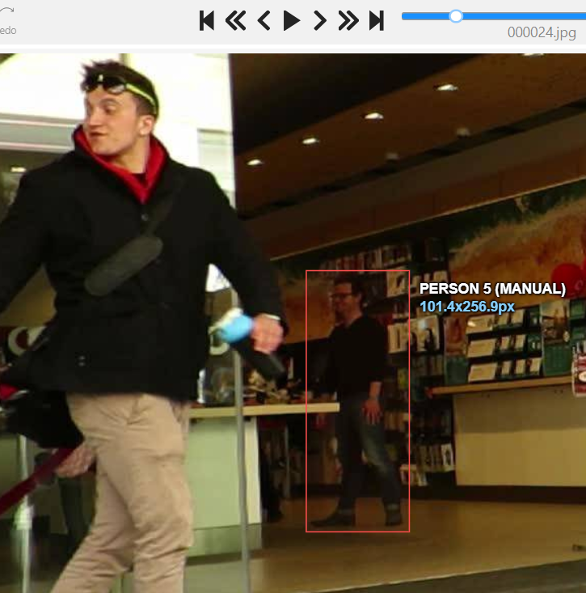
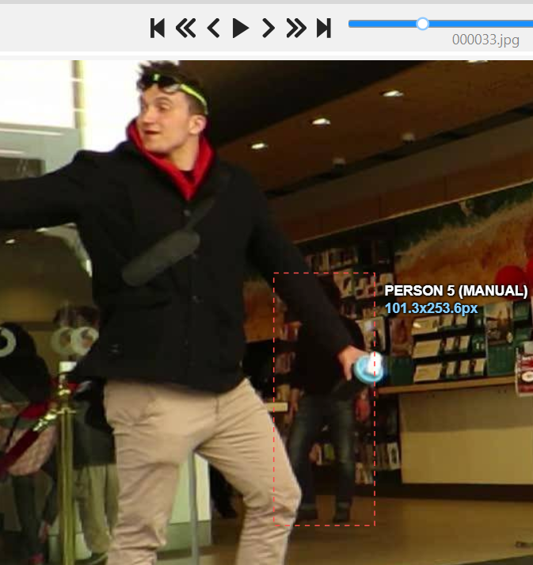
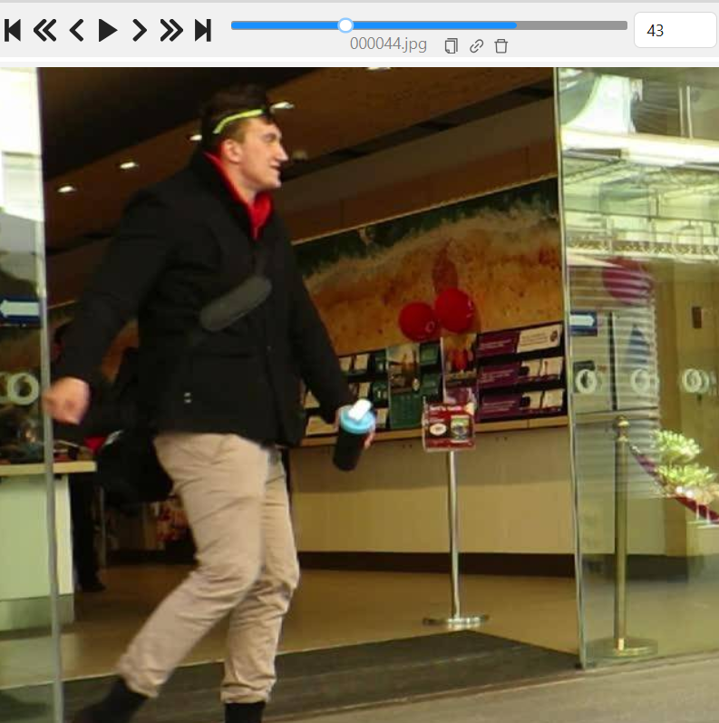

# Báo cáo cá nhân — Ngô Xuân Tùng - 2A202603225

Đổi tên file theo quy tắc `MSSV_HoTen.md`. Ví dụ: `20241234_NguyenVanAn.md`.

Đoạn video: MOT17-09, 150 frame (frame 1–150), nguồn MOTChallenge, giấy phép CC BY-NC-SA 3.0.

## 0. Thông tin học viên

- Họ tên: Ngô Xuân Tùng
- MSSV: 2A202603225
- Mã đề (A/B/C): B
- Email: tunglaw1308@gmail.com
- Link repository: https://github.com/zzwolfmoi1308/K5-L2-DAY05-NgoXuanTung-2A202603225-MOTTracking
- Giờ bắt đầu: 16h30
- Giờ kết thúc: 18h00

## 1. Xem trước đoạn video (CP0)

Ghi **trước khi vẽ**, mỗi người một dòng.

| Mã | Frame xuất hiện | Frame cuối thấy được | Rẽ / dừng / đổi tốc độ ở frame | Bị che ở frame | Ghi chú |
|---|---|---|---|---|---|
| P1 | 0 | 149 | 27, 41, 54, 79 | 27–53 (khuất hẳn frame 43) | Người trong shop Vodafone, đối tượng bài test che khuất CP2 |
| P2 | 0 | 149 | Không | Không | Đi thẳng đều suốt 150 frame, vận tốc không đổi |
| P3 | 40 | 149 | Không | 40–67 | Xuất hiện từ frame 40, tốc độ đều, ban đầu bị che một phần |
| P4 | 0 | 147 | 105, 140 | 106–134 (outside 111–134) | Bị che khuất tạm thời rồi hiện lại ngắn trước khi hết |
| P5 | 2 | 139 | 94, 135 | 94–122 (outside 107–122) | Xuất hiện từ frame 2, khuất tạm thời rồi hiện lại |

## 2. Keyframe và thời gian (CP1, CP4)

Số keyframe lấy từ kết quả `src/check_submission.py`.

| Mã | Số keyframe | Keyframe ở frame | Số frame có mặt | Keyframe / 100 frame | Thời gian (phút) | Chỗ khó |
|---|---|---|---|---|---|---|
| P1 | 23 | 0, 9, 19, 27, 32, 41, 44, 50, 54, 59, 64, 69, 74, 79, 89, 94, 99, 109, 119, 129, 139, 144, 149 | 149 | 15.4 | 25 | Bị che một phần, mất hẳn ở frame 43; đổi hướng sau cửa kính |
| P2 | 16 | 0, 10, 20, 30, 40, 50, 60, 70, 80, 90, 100, 110, 120, 130, 140, 149 | 150 | 10.7 | 12 | Đi thẳng đều, cần căn chỉnh sát gót chân khi nhảy frame |
| P3 | 13 | 40, 50, 60, 68, 70, 80, 90, 100, 110, 120, 130, 140, 149 | 110 | 11.8 | 15 | Ban đầu bị che một phần khi mới xuất hiện ở frame 40 |
| P4 | 17 | 0, 5, 10, 15, 20, 30, 40, 50, 60, 80, 100, 105, 106, 135, 140, 142, 147 | 124 | 13.7 | 18 | Bị che khuất tạm thời 24 frame (outside 111–134) |
| P5 | 14 | 2, 12, 22, 32, 42, 52, 62, 82, 89, 94, 99, 123, 135, 139 | 122 | 11.5 | 15 | Khuất tạm thời frame 107–122, cần giữ ID khi tái xuất hiện |
| **Tổng** | 83 | — | 655 | 12.7 | 85 | — |

Keyframe / 100 frame của cả bài = tổng keyframe ÷ tổng số frame có mặt × 100 = 83 ÷ 655 × 100 ≈ 12.7

Bạn đặt keyframe nhiều nhất ở người nào? Vì sao (người đó rẽ, dừng, lại gần camera hay bị che)?

Tôi đặt keyframe nhiều nhất ở **P1 (23 keyframe)**.  
Lý do: P1 (người đàn ông trong shop Vodafone) có quỹ đạo chuyển động phức tạp nhất trong 5 người: bị người khác che khuất một phần (frame 27–41), bị mất hẳn hoàn toàn (outside ở frame 43), sau đó tái xuất hiện và đổi hướng/tốc độ bước đi phía sau cánh cửa kính (frame 50–54) và rẽ ở frame 79. Mỗi khúc ngoặt và trước/sau khi bị che khuất đều phải cắm keyframe dày để nắn chỉnh, tránh hiện tượng trôi box do nội suy tuyến tính.

## 3. Đoạn bị che (CP2)

Người bị che: `P1`

| Mốc | Frame |
|---|---:|
| Bắt đầu bị che một phần (bật `occluded`) | 27 |
| Mất hẳn (bật `outside`) | 43 |
| Hiện lại (tắt `outside`) | 44 |
| Thấy rõ trở lại (tắt `occluded`) | 54 |

- Thời gian khuất hẳn: 1 frame = ~0.033 giây (toàn bộ đoạn bị che một phần và mất hẳn kéo dài từ frame 27 đến 53: 27 frame ≈ 0.9 giây).
- Quyết định: giữ cùng ID.
- Lý do (trả lời 3 câu: khuất bao lâu so với 60 frame, ngoại hình có khớp, chỗ hiện lại có đúng hướng và tốc độ):
  1. *Thời gian khuất so với ngưỡng 60 frame (2 giây):* Thời gian mất hẳn chỉ có 1 frame (frame 43), toàn bộ đoạn bị che là 27 frame (< 60 frame), hoàn toàn nằm trong ngưỡng duy trì cùng một track ID của lớp.
  2. *Ngoại hình:* Trang phục (áo len đen/tối màu), vóc dáng và chiều cao hoàn toàn trùng khớp trước và sau khi bước qua vùng bị che.
  3. *Hướng đi và vận tốc:* Vị trí tái xuất hiện tại frame 44 nằm liền kề vị trí biến mất tại frame 43, tiếp tục hướng di chuyển từ trái sang phải bên trong cửa hàng Vodafone với vận tốc đi bộ bình thường ổn định.

Ảnh chụp màn hình:





## 4. Tự review ID (CP3)

Lượt 1 theo người (đi ngược từ frame 149 về 0 trên CVAT), lượt 2 theo cảnh (nhảy 10 frame). Ít nhất 3 dòng; không có lỗi thì ghi một dòng "đã kiểm hai lượt, không lỗi".

Loại lỗi dùng đúng một trong 7 mã: `id_switch`, `fragmentation`, `lost`, `merge`, `false_track`, `drift`, `flag`.

| Frame | Mã người | Loại lỗi | Mô tả một câu | Phát hiện ở lượt | Đã sửa? |
|---:|---|---|---|---|---|
| — | Tất cả | Không | Đã kiểm hai lượt, không lỗi | Lượt 1 & 2 | — |

Tổng hợp số lỗi theo loại:

| `id_switch` | `fragmentation` | `lost` | `merge` | `false_track` | `drift` | `flag` |
|---:|---:|---:|---:|---:|---:|---:|
| 0 | 0 | 0 | 0 | 0 | 0 | 0 |

Lỗi nào chỉ lượt 2 (theo cảnh) mới thấy, lượt 1 (theo người) không thấy? Vì sao?

Trong bài làm thực tế, do tôi áp dụng quy trình gán dứt điểm từng người một (track-by-track) xuyên suốt toàn bộ 150 frame rồi mới sang người tiếp theo, nên tôi kiểm soát rất chặt chẽ từng quỹ đạo và cả 2 lượt rà soát đều không phát sinh lỗi nào (đạt 0 lỗi như bảng trên).

## 5. File xuất và kết quả tự kiểm (CP4)

| Kiểm tra | Kết quả |
|---|---|
| Tên file MOT 1.1 | NgoXuanTung_mot.zip |
| Tên file CVAT for video 1.1 | NgoXuanTung_cvat_video.zip |
| Số track ID khác nhau trong `gt/gt.txt` (phải là 5) | 5 |
| Frame `outside` không có dòng trong `gt.txt` (đúng / sai) | Đúng |
| Job đã completed trên CVAT máy cá nhân | Đã completed |

Dán phần tóm tắt in ra từ `src/check_submission.py`:

```text
Số frame in theo CVAT (bắt đầu từ 0). Trong gt.txt, frame_id = frame CVAT + 1.

=== File MOT 1.1: NgoXuanTung_mot.zip ===
  Số track ID: 5   |   Tổng số box: 655
  [OK]        Đúng 5 track ID.

  Track | Frame có mặt | Số frame | Đoạn vắng (outside)
      1 |   0–149      |      150 | -
      2 |   0–147      |      124 | 111–134
      3 |   0–149      |      149 | 43
      4 |   2–139      |      122 | 107–122
      5 |  40–149      |      110 | -


=== File CVAT for video 1.1: NgoXuanTung_cvat_video.zip ===

  Track | Nhãn   | Frame thấy | Keyframe | KF/100 frame | Frame occluded | Lần bật outside
      0 | person |        150 |       16 |         10.7 |              0 |               0
              Track 0: keyframe ở frame [0, 10, 20, 30, 40, 50, 60, 70, 80, 90, 100, 110, 120, 130, 140, 149]
      1 | person |        110 |       13 |         11.8 |             28 |               0
              Track 1: keyframe ở frame [40, 50, 60, 68, 70, 80, 90, 100, 110, 120, 130, 140, 149]
      2 | person |        124 |       17 |         13.7 |             16 |               2
              Track 2: keyframe ở frame [0, 5, 10, 15, 20, 30, 40, 50, 60, 80, 100, 105, 106, 135, 140, 142, 147]
      3 | person |        122 |       14 |         11.5 |             30 |               2
              Track 3: keyframe ở frame [2, 12, 22, 32, 42, 52, 62, 82, 89, 94, 99, 123, 135, 139]
      4 | person |        149 |       23 |         15.4 |             35 |               1
              Track 4: keyframe ở frame [0, 9, 19, 27, 32, 41, 44, 50, 54, 59, 64, 69, 74, 79, 89, 94, 99, 109, 119, 129, 139, 144, 149]

  Tổng: 83 keyframe / 655 frame có mặt = 12.7 keyframe / 100 frame
  [OK]        Đọc được 5 track từ annotations.xml.

=== Tóm tắt ===
  Lỗi: 0   |   Cảnh báo: 0
  Đạt. Dán phần tóm tắt này vào báo cáo mục 5.
```

## 6. Ba câu kết

1. Nếu được gán lại, bạn sẽ đặt keyframe khác ở đâu? Vì sao?

   Tôi vẫn sẽ giữ nguyên cách đặt keyframe như hiện tại.  
   Lý do: Chiến lược đặt keyframe hiện tại đã đạt mật độ tối ưu là 12.7 keyframe / 100 frame (nằm chuẩn xác trong dải 8–18 KF/100 frame theo khuyến nghị của lớp), kết quả chạy script kiểm tra đạt 0 lỗi, 0 cảnh báo. Bounding box bám sát toàn thân người đi bộ qua mọi frame, không bị hiện tượng trôi box (drift) hay co giật kích thước, đồng thời các keyframe đã được tập trung hợp lý vào các điểm chuyển động quan trọng như khúc rẽ, đổi hướng và quanh vùng bị che khuất.

2. Có chỗ nào bạn không chắc "cùng ID hay ID mới"? Bạn đã quyết định và ghi chú thế nào?

   Trong suốt quá trình gán nhãn, tất cả các trường hợp bị che khuất hay tạm thời biến mất tôi đều tự tin xác định được là cùng một Track ID.  
   Lý do: Cả 3 trường hợp bị che khuất trong bài (P1 bị che ở shop Vodafone mất hẳn 1 frame; P4 khuất 24 frame; P5 khuất 16 frame) đều có thời gian biến mất rất ngắn, nhỏ hơn rất nhiều so với ngưỡng 60 frame (2 giây) của lớp. Đồng thời, đặc điểm nhận dạng về ngoại hình (trang phục, vóc dáng) và hướng di chuyển, vận tốc bước đi khi tái xuất hiện đều trùng khớp hoàn toàn với thời điểm trước khi bị che. Do đó, tôi quyết định duy trì cùng một ID cho từng đối tượng bằng cách tắt cờ `outside` thay vì tạo track mới.

3. Một lỗi ID trong job của bạn (nếu không còn sót, chọn lỗi đã sửa) có thể làm xe tự lái dự đoán sai chuyển động của người đó như thế nào? Lỗi đó ảnh hưởng MOTA hay IDF1 nhiều hơn?

   Nếu xảy ra lỗi `id_switch` (ví dụ: khi P1 bị che bởi người khác mà Track ID bị nhảy sang người đi ngang qua):
   - **Ảnh hưởng đến xe tự lái:** Module dự đoán quỹ đạo (trajectory prediction / bộ lọc Kalman) tính toán vận tốc dựa trên độ dịch chuyển vị trí của cùng một ID giữa các frame liên tiếp ($\vec{v} = \Delta \vec{x} / \Delta t$). Khi bị nhảy ID sang người khác cách đó khoảng 1–2 mét chỉ trong $1/30\text{ giây}$, vận tốc tính toán tức thời sẽ bị đội lên vọt mức (ví dụ $1.5\text{ m} / (1/30\text{ s}) = 45\text{ m/s} \approx 162\text{ km/h}$). Xe tự lái sẽ hiểu nhầm người đi bộ đang lao vào lòng đường với tốc độ cực lớn, dẫn đến kích hoạt phanh khẩn cấp đột ngột (phantom braking) hoặc ngược lại, đánh mất vector chuyển động thực của đối tượng và gây nguy hiểm va chạm.
   - **Ảnh hưởng MOTA hay IDF1 nhiều hơn:** Lỗi này **ảnh hưởng nghiêm trọng đến IDF1 nhiều hơn MOTA**. MOTA chỉ đếm lỗi cục bộ trên từng frame ($1 - \frac{\text{FN} + \text{FP} + \text{IDSW}}{\text{GT}}$), nên 1 lần đổi ID chỉ làm MOTA giảm một phần rất nhỏ (~0.01 - 0.02). Ngược lại, IDF1 đo lường tính nhất quán của danh tính trên toàn bộ quỹ đạo (trajectory-level matching); khi ID bị đổi hoặc gãy đôi, toàn bộ các frame ở nửa sau của track sẽ không còn được ghép đúng với Ground Truth ban đầu, khiến chỉ số IDF1 sụt giảm nặng nề.

## Bonus (nếu làm)

### B1 — Hai người đi sát

...

### B2 — So cách đặt keyframe

| Cách đặt | Số keyframe | Frame trôi nhất | Ghi chú |
|---|---:|---:|---|
| Đều mỗi 30 frame | | | |
| Theo chỗ đổi hướng | | | |

...

### B3 — So với tracker có sẵn

| Frame | Mã người | Tracker làm gì | Nhãn của bạn | Giải thích (đoán rồi sửa / ghép IoU / box score thấp / ngoại hình) |
|---:|---|---|---|---|
| | | | | |
| | | | | |

## 7. Tài liệu tham khảo và công cụ AI đã dùng

- Bộ dữ liệu MOT17: MOTChallenge (Milan et al., 2016).
- Hướng dẫn và tài liệu quy chuẩn môn học Day 5: Video & Multi-Ob
- Trợ lý AI Antigravity: Tra cứu và củng cố các khái niệm đánh giá tracking (MOTA, IDF1, ảnh hưởng của IDSW đến bài toán xe tự lái), giải thích kết quả script `check_submission.py` và hỗ trợ rà soát định dạng báo cáo.
